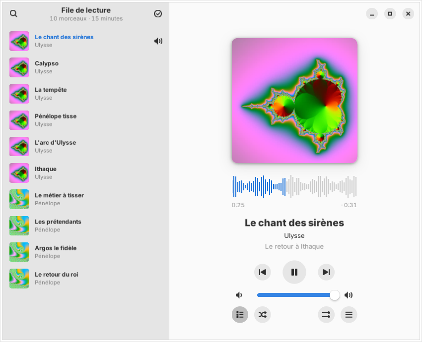
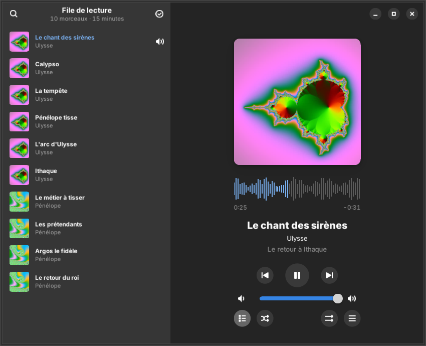
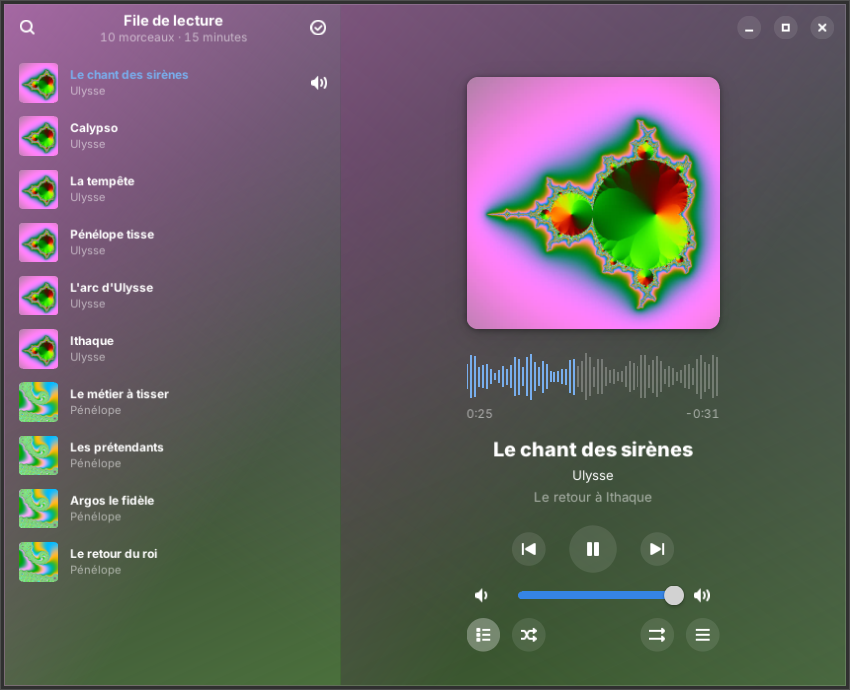
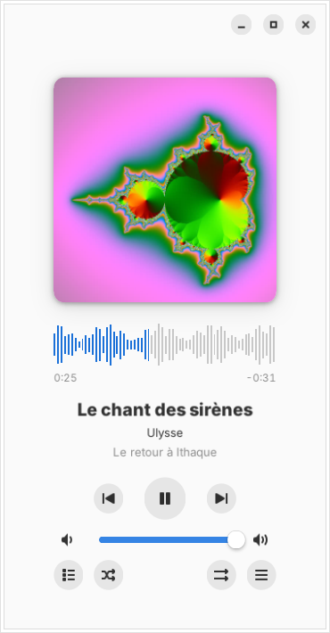
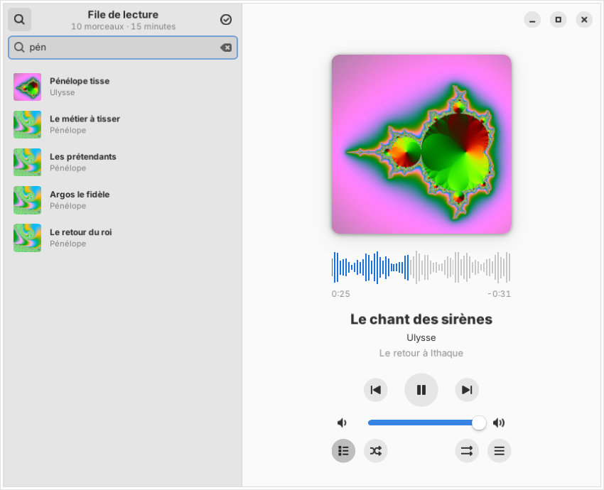
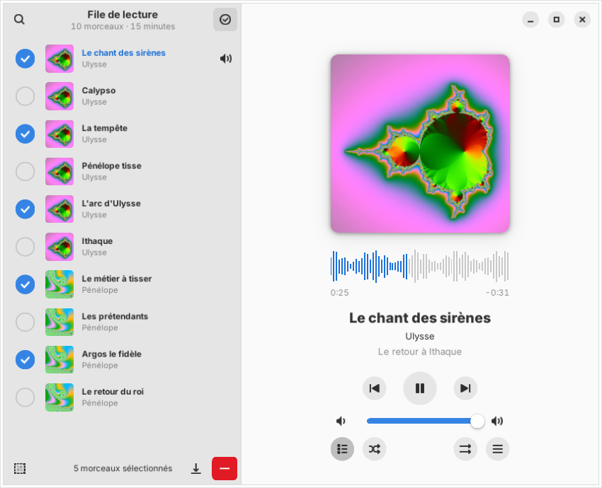
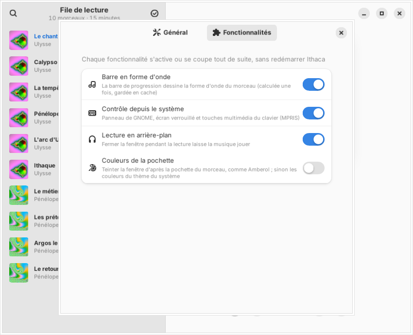

# Ithaca

**A small GTK4 / libadwaita music player for GNOME that plays your music, and nothing else. Inspired by Amberol, without Flatpak.**
**Un petit lecteur de musique GTK4 / libadwaita pour GNOME, qui joue votre musique et rien d'autre. Inspiré d'Amberol, sans Flatpak.**

[English](#english) · [Français](#français) · [Website / Site](https://tofmicro.pages-perso.free.fr/Ithaca/)



| Dark mode / Mode sombre | Cover colors / Couleurs de la pochette | Narrow window / Fenêtre étroite |
|---|---|---|
|  |  |  |

| Search the queue / Recherche dans la file | Selection / Sélection | Features / Fonctionnalités |
|---|---|---|
|  |  |  |

---

## English

Ithaca is a music player in the spirit of [Amberol](https://gitlab.gnome.org/World/amberol): no library to
manage, no tags to edit — you open songs, folders or playlists and they join the play queue. Amberol only ships
as a Flatpak and needs GTK 4.16; Ithaca is a rewrite in Python for Ubuntu 24.04 / Zorin OS 18 (GTK 4.14,
libadwaita 1.5), using the distribution's GStreamer. It follows your desktop's GTK theme (Adwaita, light/dark,
accent color), or, if you wish, tints the window after the album cover like Amberol.

### Features

- **No library**: open songs or folders (buttons, drag and drop, "Open With" from your file manager, command
  line). Folders are read in natural order (1, 2… 10). The queue is remembered: **Restore Playlist** brings it
  back with the song and position where you left off.
- **Large cover art** (embedded in the file, or `cover.jpg` / `folder.png`… from the folder), **waveform
  progress bar** (click or drag to seek, ← / → keys), title, artist, album.
- **Gapless playback**, shuffle, repeat (playlist or song), **search in the queue** (accents ignored),
  selection mode to remove songs, drag and drop to reorder the queue.
- **Playlists**: `.m3u`, `.m3u8`, `.xspf` and `.pls` open like folders; save the queue or a selection as a
  playlist (relative paths: the playlist still works when copied with the music to a USB stick), or add songs
  to an existing playlist without duplicates. Existing playlists are never overwritten by accident.
- **Web radios** from playlists, played live, with the song title announced by the station and its logo
  (`tvg-logo` from the playlist, or the station's website icon).
- **ReplayGain** (album or song), applied live without interrupting the music, never clipping.
- **System controls (MPRIS)**: GNOME panel, lock screen and keyboard media keys.
- **Background playback**: closing the window while playing keeps the music going, with a tray icon (via the
  [AppIndicator extension](https://github.com/ubuntu/gnome-shell-extension-appindicator)) and a notification
  to show the window again or quit. No automatic suspend while music is playing.
- Each optional feature (waveform, system controls, background playback, cover colors) can be switched off
  in **Preferences → Features**, without restarting.

### Installation

**Ubuntu 24.04 / 26.04, Zorin OS 18, Linux Mint 22** — from the PPA, updates then come with the system's:

```sh
sudo add-apt-repository ppa:nourpon/ithaca
sudo apt update && sudo apt install ithaca
```

**Other Debian-based distributions (Debian 13…)**: download the `.deb` from the
[Releases](https://github.com/ToFpon/Ithaca/releases) page, then `sudo apt install ./ithaca_X_all.deb`.

**Try it without installing** (or install it in `~/.local` with `./install.sh`, `./install.sh --uninstall` to
remove it):

```sh
sudo apt install python3-gi gir1.2-gtk-4.0 gir1.2-adw-1 gir1.2-gstreamer-1.0 gir1.2-gst-plugins-base-1.0 gstreamer1.0-plugins-good
git clone https://github.com/ToFpon/Ithaca.git
cd Ithaca
./bin/ithaca
```

Less common formats (WMA, APE…): `sudo apt install gstreamer1.0-libav`.

#### Command line

```sh
ithaca ~/Music/an-album          # add a folder and play it
ithaca song.flac list.m3u        # songs and playlists
ithaca --version
```

If Ithaca is already running, the files are sent to it.

#### Keyboard shortcuts

| Space | Play / pause | Ctrl+← / Ctrl+→ | Previous / next song |
|---|---|---|---|
| Shift+← / Shift+→ | Back / forward 10 seconds (set in Preferences) | Ctrl+M | Mute |
| Ctrl+O | Add songs | Ctrl+Shift+O | Add a folder |
| Ctrl+F | Search the queue | F9 | Show the queue |
| Ctrl+, | Preferences | Ctrl+Q | Quit |

### Languages

French, English, German (follows the system language, or chosen in Preferences).

### Tests

The engine (tags, covers, queue, GStreamer player, gapless playback, ReplayGain, waveform, playlists, web
radio), MPRIS, the tray icon and the interface are tested with real GStreamer and music generated by ffmpeg —
see `CLAUDE.md`.

### License

GPL-3.0-or-later. Inspired by [Amberol](https://gitlab.gnome.org/World/amberol) by Emmanuele Bassi, rewritten in
Python; foundations shared with [Odysseus](https://github.com/ToFpon/Odysseus).

---

## Français

Ithaca est un lecteur de musique dans l'esprit d'[Amberol](https://gitlab.gnome.org/World/amberol) : pas de
bibliothèque à gérer, pas d'étiquettes à modifier — on ouvre des morceaux, des dossiers ou des listes de lecture
et ils rejoignent la file. Amberol n'existe qu'en Flatpak et demande GTK 4.16 ; Ithaca est une réécriture en
Python pour Ubuntu 24.04 / Zorin OS 18 (GTK 4.14, libadwaita 1.5), avec le GStreamer de la distribution. Il suit
le thème GTK du bureau (Adwaita, clair / sombre, couleur d'accentuation), ou, si tu le veux, teinte la fenêtre
d'après la pochette comme Amberol.

### Fonctionnalités

- **Pas de bibliothèque** : on ouvre des morceaux ou des dossiers (boutons, glisser-déposer, « Ouvrir avec »
  depuis le gestionnaire de fichiers, ligne de commande). Dossiers lus dans l'ordre naturel (1, 2… 10). La file
  est retenue : **Restaurer la file** la remet, sur le morceau et à la position où on l'avait laissée.
- **Grande pochette** (intégrée au fichier, ou `cover.jpg` / `folder.png`… du dossier), **barre de progression
  en forme d'onde** (clic ou glisser pour avancer, touches ← / →), titre, artiste, album.
- **Enchaînement sans blanc**, aléatoire, répétition (file ou morceau), **recherche dans la file** (accents
  ignorés), mode sélection pour retirer des morceaux, glisser-déposer pour réordonner la file.
- **Listes de lecture** : `.m3u`, `.m3u8`, `.xspf` et `.pls` s'ouvrent comme des dossiers ; enregistrer la file
  ou une sélection en liste (chemins relatifs : copiée avec la musique sur une clé, elle marche toujours), ou
  compléter une liste existante sans doublon. Une liste existante n'est jamais écrasée par mégarde.
- **Webradios** des listes, lues en direct, avec le titre annoncé par la station et son logo
  (`tvg-logo` de la liste, ou l'icône du site de la station).
- **ReplayGain** (album ou morceau), appliqué en direct sans couper la musique, sans jamais saturer.
- **Contrôle depuis le système (MPRIS)** : panneau de GNOME, écran verrouillé et touches multimédia du clavier.
- **Lecture en arrière-plan** : fermer la fenêtre pendant la lecture laisse la musique jouer, avec une icône dans
  la barre système (par l'[extension AppIndicator](https://github.com/ubuntu/gnome-shell-extension-appindicator))
  et une notification pour revenir ou quitter. Pas de mise en veille automatique pendant la lecture.
- Chaque fonctionnalité facultative (forme d'onde, contrôle depuis le système, arrière-plan, couleurs de la
  pochette) se coupe dans **Préférences → Fonctionnalités**, sans redémarrer.

### Installation

**Ubuntu 24.04 / 26.04, Zorin OS 18, Linux Mint 22** — par le PPA, les mises à jour arrivent ensuite avec
celles du système :

```sh
sudo add-apt-repository ppa:nourpon/ithaca
sudo apt update && sudo apt install ithaca
```

**Autres distributions basées sur Debian (Debian 13…)** : télécharger le `.deb` de la page
[Releases](https://github.com/ToFpon/Ithaca/releases), puis `sudo apt install ./ithaca_X_all.deb`.

**Essayer sans installer** (ou installer dans `~/.local` avec `./install.sh`, `./install.sh --uninstall` pour
retirer) :

```sh
sudo apt install python3-gi gir1.2-gtk-4.0 gir1.2-adw-1 gir1.2-gstreamer-1.0 gir1.2-gst-plugins-base-1.0 gstreamer1.0-plugins-good
git clone https://github.com/ToFpon/Ithaca.git
cd Ithaca
./bin/ithaca
```

Formats plus rares (WMA, APE…) : `sudo apt install gstreamer1.0-libav`.

#### Ligne de commande

```sh
ithaca ~/Musique/un-album        # ajouter un dossier et le lire
ithaca morceau.flac liste.m3u    # morceaux et listes de lecture
ithaca --version
```

Si Ithaca est déjà ouvert, les fichiers lui sont envoyés.

#### Raccourcis clavier

| Espace | Lecture / pause | Ctrl+← / Ctrl+→ | Morceau précédent / suivant |
|---|---|---|---|
| Maj+← / Maj+→ | Reculer / avancer de 10 secondes (réglable dans les Préférences) | Ctrl+M | Couper le son |
| Ctrl+O | Ajouter des morceaux | Ctrl+Maj+O | Ajouter un dossier |
| Ctrl+F | Rechercher dans la file | F9 | Afficher la file |
| Ctrl+, | Préférences | Ctrl+Q | Quitter |

### Langues

Français, anglais, allemand (langue du système, ou choisie dans les Préférences).

### Tests

Le moteur (étiquettes, pochettes, file, lecteur GStreamer, enchaînement sans blanc, ReplayGain, forme d'onde,
listes de lecture, webradio), MPRIS, l'icône de la barre système et l'interface sont testés avec le vrai
GStreamer et de la musique fabriquée par ffmpeg — voir `CLAUDE.md`.

### Licence

GPL-3.0 ou ultérieure. Inspiré d'[Amberol](https://gitlab.gnome.org/World/amberol) d'Emmanuele Bassi, réécrit en
Python ; socle commun avec [Odysseus](https://github.com/ToFpon/Odysseus).
